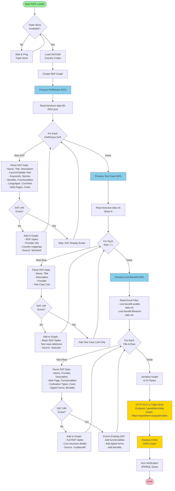

# 📊 DATs Loading Process

**QuantiFarm Switzerland - Digital Agriculture Technologies ETL Pipeline**

---

## Flowchart

---

## Legende

| Farbe | Bedeutung |
|-------|-----------|
| 🟩 Grün | Start / Ende |
| 🟦 Blau | Datenquellen |
| 🟨 Gelb | Speicheroperationen |
| ⬜ Weiss | Verarbeitungsschritte |

---

## 📁 Data Sources

- FAIRshare Platform (JSON)
- Test Case Data (Excel)
- Cost-Benefit Arable (Excel)
- Cost-Benefit Livestock (Excel)

## 🎯 Key Features

- Deduplication across sources
- Enrichment strategy for existing DATs
- RDF/Semantic Web compliant
- Destructive loading (full replace)

## 🔧 Technical Stack

- Python 3.11+ (Loader)
- Apache Jena Fuseki (Triple Store)
- RDFLib (RDF Processing)
- QCSM Ontology (Data Model)

## 📊 Output

- **Graph**: `quantifarm.eu/graphs/dats`
- **Format**: N-Triples
- **Protocol**: SPARQL Graph Store
- **Method**: HTTP PUT (Replace)

---

*QuantiFarm Switzerland | Data Platform Documentation | Generated: January 2026*
