# Cost-Benefit DATs Loading Flowchart

This flowchart visualizes the complete data flow from Excel files to the user interface for Cost-Benefit DATs.

```mermaid
flowchart TD
    Start([Start: Cost-Benefit DATs Loading]) --> ExcelFiles

    subgraph Sources["Source Data"]
        ExcelFiles[Excel Files]
        Arable[cost-benefit-arable-dats.xls<br/>Crop/Arable DATs]
        Livestock[cost-benefit-lifestock-dats.xls<br/>Livestock DATs]
        
        ExcelFiles --> Arable
        ExcelFiles --> Livestock
    end

    subgraph Loader["DATs Loader (Python)"]
        ReadExcel[Read Excel<br/>Sheet 0, Row 2+]
        ExtractData[Extract Data:<br/>- DAT Name<br/>- Provider<br/>- Description<br/>- Costs<br/>- Functionalities<br/>- Benefits]
        GenURI[Generate URI:<br/>lowercase + underscores<br/>dats/dat_name]
        CheckDupe{DAT already<br/>exists?}
        
        CreateNew[Create New DAT:<br/>- All metadata<br/>- RDF triples<br/>- Cost structure]
        EnrichExisting[Enrich Existing DAT:<br/>- Add functionalities<br/>- Add digital forms<br/>- Add benefits]
        
        SectorCheck{Which file?}
        AddCropType[Add Crop Properties:<br/>canBeUsedToCultivateCropType<br/>isTargetedTowardsAgriculturalSector]
        AddLivestockType[Add Livestock Properties:<br/>canBeUsedToCultivateLifestockType<br/>isTargetedTowardsAgriculturalSector]
        
        BuildRDF[Build RDF Graph:<br/>- DAT triples<br/>- Provider triples<br/>- Cost triples<br/>- Source: costbenefit]
        
        ReadExcel --> ExtractData
        ExtractData --> GenURI
        GenURI --> CheckDupe
        
        CheckDupe -->|No| CreateNew
        CheckDupe -->|Yes| EnrichExisting
        
        CreateNew --> SectorCheck
        EnrichExisting --> SectorCheck
        
        SectorCheck -->|Arable| AddCropType
        SectorCheck -->|Livestock| AddLivestockType
        
        AddCropType --> BuildRDF
        AddLivestockType --> BuildRDF
    end

    Arable --> ReadExcel
    Livestock --> ReadExcel

    subgraph TripleStore["Triple Store (Fuseki)"]
        PutRequest[HTTP PUT Request<br/>Destructive Loading]
        GraphStore[Graph Store:<br/>https://quantifarm.eu/graphs/dats]
        SPARQLEndpoint[SPARQL Endpoint:<br/>localhost:3030/quantifarm]
        
        PutRequest --> GraphStore
        GraphStore --> SPARQLEndpoint
    end

    BuildRDF --> PutRequest

    subgraph APIs["Cost-Benefit Calculator APIs"]
        V1API[API Version 1<br/>Port 8688<br/>Generic Calculations]
        V2API[API Version 2<br/>Port 8687<br/>Test Case Specific]
        
        QueryTriple1[Query Triple Store<br/>Crop & Livestock DATs]
        QueryTriple2[Query Triple Store<br/>TC Crop & TC Livestock]
        
        BuildTree1[Build Hierarchical Tree:<br/>Cultivation Type → Functionality → DAT]
        BuildTree2[Build Hierarchical Tree:<br/>TC → Functionality → DAT]
        
        V1API --> QueryTriple1
        V2API --> QueryTriple2
        QueryTriple1 --> BuildTree1
        QueryTriple2 --> BuildTree2
    end

    SPARQLEndpoint --> QueryTriple1
    SPARQLEndpoint --> QueryTriple2

    subgraph Backend["Backend (tool2.php)"]
        VersionSelect{Version<br/>Parameter?}
        RouteV1[Route to API v1<br/>localhost:8688]
        RouteV2[Route to API v2<br/>localhost:8687]
        ProxyRequest[Proxy Request:<br/>/dat_tree + myDatType]
        
        VersionSelect -->|1| RouteV1
        VersionSelect -->|2| RouteV2
        RouteV1 --> ProxyRequest
        RouteV2 --> ProxyRequest
    end

    BuildTree1 --> VersionSelect
    BuildTree2 --> VersionSelect

    subgraph Frontend["Frontend (tool2.js & tool2.html)"]
        LoadData[LoadData Function]
        
        LoadCrop[Load Crop DATs<br/>version: 1<br/>type: crop]
        LoadLive[Load Livestock DATs<br/>version: 1<br/>type: livestock]
        LoadCropTC[Load Crop TC DATs<br/>version: 2<br/>type: cropTC]
        LoadLiveTC[Load Livestock TC DATs<br/>version: 2<br/>type: livestockTC]
        
        IndexTree[Index Tree Structure<br/>dataTree object]
        
        RenderUI[Render UI Tree:<br/>- Cultivation Types<br/>- Functionalities<br/>- Individual DATs]
        
        UserInteraction[User Interaction:<br/>- Browse DATs<br/>- Select DAT<br/>- Input Parameters<br/>- Calculate Benefits]
        
        LoadData --> LoadCrop
        LoadData --> LoadLive
        LoadData --> LoadCropTC
        LoadData --> LoadLiveTC
        
        LoadCrop --> IndexTree
        LoadLive --> IndexTree
        LoadCropTC --> IndexTree
        LoadLiveTC --> IndexTree
        
        IndexTree --> RenderUI
        RenderUI --> UserInteraction
    end

    ProxyRequest --> LoadData
    
    UserInteraction --> Results([Results Display:<br/>Cost Savings<br/>ROI<br/>Benefits])

    style Sources fill:#e1f5ff
    style Loader fill:#fff4e6
    style TripleStore fill:#f3e5f5
    style APIs fill:#e8f5e9
    style Backend fill:#fff3e0
    style Frontend fill:#fce4ec
    style Start fill:#c8e6c9
    style Results fill:#c8e6c9
```

## Key Flow Steps

### 1. **Data Source**
- Two Excel files containing Cost-Benefit DAT definitions
- Separate files for Arable and Livestock farming

### 2. **ETL Process**
- DATs Loader reads Excel row by row (skipping headers)
- Generates semantic URIs from DAT names
- Checks for existing DATs and either creates new or enriches existing
- Differentiates between Crop and Livestock properties
- Builds RDF graph with QCSM-compliant triples

### 3. **Storage**
- HTTP PUT to Fuseki Triple Store
- Destructive loading (replaces entire graph)
- Stored in named graph: `https://quantifarm.eu/graphs/dats`

### 4. **API Layer**
- Two API versions serve different purposes:
  - **v1 (8688)**: Generic crop and livestock calculations
  - **v2 (8687)**: Test Case specific calculations
- Both query the Triple Store and build hierarchical trees

### 5. **Backend Proxy**
- tool2.php routes requests to appropriate API version
- Proxies `/dat_tree` endpoint with version parameter

### 6. **Frontend Display**
- tool2.js loads 4 data types in parallel
- Indexes trees for efficient lookup
- Renders interactive UI for user selection
- Enables cost-benefit calculations with user inputs

## Data Flow Paths

1. **Commercial Crop DATs**: Excel → Loader → Triple Store → API v1 → PHP → JS → HTML
2. **Commercial Livestock DATs**: Excel → Loader → Triple Store → API v1 → PHP → JS → HTML
3. **Test Case Crop DATs**: Excel → Loader → Triple Store → API v2 → PHP → JS → HTML
4. **Test Case Livestock DATs**: Excel → Loader → Triple Store → API v2 → PHP → JS → HTML
