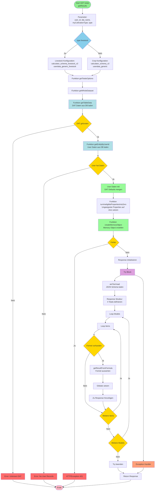

# Cost-Benefit Calculator v1 - getResults Funktion Flowchart

## Übersicht
Die `getResults` Funktion ist ein FastAPI Endpoint, der die Gesamtberechnungen (Totals) für einen bestimmten DAT (Digital Agriculture Technology) durchführt.

## Beschreibung

### Eingabeparameter
- **user_id**: Benutzer-ID
- **dat_name**: Name der Digitalen Agrartechnologie
- **myCultivationType**: Typ der Kultivierung (z.B. arable, fruits, cattle, pigs)
- **type**: Haupttyp (crop oder livestock)

### Hauptschritte

1. **Typ-Erkennung**: Unterscheidet zwischen Crop und Livestock

2. **getTotalsOptions**: Zentrale Datenbeschaffungsfunktion
   - **getWholeDataset**: Kombiniert DAT-Daten und User-Daten
   - **getTableData**: Lädt DAT-Daten aus PostgreSQL (z.B. Investment, Yield, Fertilizer)
   - **getEntityByUserId**: Lädt User-spezifische Daten aus DB
   - **Merge**: User-Daten überschreiben DAT-Defaults
   - **turnIneligiblePropertiesIntoZero**: Setzt ungeeignete Properties auf 0
   - **createMemoryObject**: Erstellt Memory-Object für Berechnungen

3. **Response-Struktur**: 4 Haupttotals
   - annual_change_in_net_income
   - costs_saving
   - return_on_investment
   - net_benefit

4. **Formelauswertung**:
   - Iteriert durch Models (investment, yield, fertilizer_reduction, etc.)
   - Wertet Excel-Formeln aus
   - Speichert in Globals mit Suffix "3" (A3, B3, etc.)

5. **Rückgabe**: Vollständiges Response-Objekt mit allen berechneten Werten

### Wichtige Datenbankfunktionen

- `getTableData(cultivationType, filter)`: Lädt DAT-Daten für spezifischen Typ (z.B. arable, cattle)
- `getEntityByUserId(entity, user_id)`: Lädt User-spezifische Input-Daten
- Die User-Daten überschreiben die Default-Werte aus der DAT-Tabelle

### Unterschiede zu v2
- Feste Totals-Liste (v2 hat unterschiedliche für Crop/Livestock)
- Verwendet CultivationType Parameter statt cfilter und tcnumber
- Globals mit Suffix "3" (v2 ohne Suffix)

### Fehlerbehandlung
- Unknown DAT: Error 401 wenn DAT nicht in DB gefunden
- No User Records: Error 401 wenn User keine Daten hat
- Memory Object Error: Error 401 bei Problemen beim Erstellen
- Try-Catch für Formelauswertung
- Try-Catch Block für die gesamte Verarbeitung
- HTTPException 401 bei Fehlern in getTotalsOptions
- Fehlerausgabe in Console bei Exceptions während der Formelauswertung
