# Cost-Benefit Calculator v2 - getResults Funktion Flowchart

## Übersicht
Die `getResults` Funktion ist ein FastAPI Endpoint, der die Gesamtberechnungen (Totals) für einen bestimmten DAT (Digital Agriculture Technology) und Test Case durchführt.

```mermaid
flowchart TD
    Start([Start GET totals<br/>getResults]) --> InputParams[Parameter:<br/>user_id, dat_name, tcnumber,<br/>cfilter, type]
    
    InputParams --> CheckType{type livestock}
    
    CheckType -->|Ja| SetLivestock[Livestock Konfiguration:<br/>calculator_schema_livestock<br/>userdata_generic_livestock<br/>tableStartingLetter A]
    
    CheckType -->|Nein| SetCrop[Crop Konfiguration:<br/>calculator_schema<br/>userdata_generic<br/>tableStartingLetter A]
    
    SetLivestock --> BuildFilter[SearchFilter aufbauen:<br/>datss_name, crop_or_animal_type,<br/>test_case_number]
    SetCrop --> BuildFilter
    
    BuildFilter --> CallGetTotals[Funktion getTotalsOptions]
    
    CallGetTotals --> GetWholeDataset[Funktion getWholeDataset]
    
    GetWholeDataset --> GetTableData[Funktion getTableData<br/>DAT und TestCase Daten aus DB laden]
    
    GetTableData --> CheckDAT{Daten gefunden}
    
    CheckDAT -->|Nein| ErrorDAT[Error: Resource not found]
    ErrorDAT --> End([Ende])
    
    CheckDAT -->|Ja| GetEntityByUser[Funktion getEntityByUserId<br/>User Daten aus DB laden]
    
    GetEntityByUser --> CheckUser{User hat Daten}
    
    CheckUser -->|Nein| ErrorUser[Error: No User Records]
    ErrorUser --> End
    
    CheckUser -->|Ja| MergeData[User Daten mit<br/>DAT Defaults mergen]
    
    MergeData --> TurnZero[Funktion turnIneligiblePropertiesIntoZero<br/>Ungeeignete Properties auf Zero setzen]
    
    TurnZero --> CreateMemory[Funktion createMemoryObject<br/>Memory Object erstellen]
    
    CreateMemory --> CheckError{Fehler}
    
    CheckError -->|Ja| ThrowError[HTTPException 401]
    ThrowError --> End
    
    CheckError -->|Nein| InitResponse[Response initialisieren]
    
    InitResponse --> TryBlock[Try Block]
    
    TryBlock --> LoadJSON[amTool.load<br/>JSON Schema laden]
    
    LoadJSON --> CheckTypeCrop{type crop}
    
    CheckTypeCrop -->|Ja| BuildCropResponse[Crop Response mit 10 Totals]
    CheckTypeCrop -->|Nein| BuildLivestockResponse[Livestock Response mit 14 Totals]
    
    BuildCropResponse --> LoopModels[Loop Models]
    BuildLivestockResponse --> LoopModels
    
    LoopModels --> LoopItems[Loop Items]
    
    LoopItems --> CheckFunction{Formel vorhanden}
    
    CheckFunction -->|Ja| EvalFormula[getResultFromFormula<br/>Formel auswerten]
    CheckFunction -->|Nein| NextItem{Weitere Items}
    
    EvalFormula --> SetGlobal[Globals setzen ohne Suffix]
    
    SetGlobal --> AddToResponse[Zu Response hinzufügen]
    
    AddToResponse --> NextItem
    
    NextItem -->|Ja| LoopItems
    NextItem -->|Nein| NextModel{Weitere Models}
    
    NextModel -->|Ja| LoopModels
    NextModel -->|Nein| ExitTry[Try beenden]
    
    ExitTry --> ReturnResponse[Return Response]
    
    TryBlock --> CatchException[Exception Handler]
    CatchException --> ReturnResponse
    
    ReturnResponse --> End

    style Start fill:#90EE90
    style End fill:#FFB6C1
    style ErrorDAT fill:#FF6B6B
    style ErrorUser fill:#FF6B6B
    style ThrowError fill:#FF6B6B
    style CheckError fill:#FFD700
    style CheckType fill:#87CEEB
    style CheckTypeCrop fill:#87CEEB
    style CheckDAT fill:#FFD700
    style CheckUser fill:#FFD700
    style CheckFunction fill:#FFD700
    style NextItem fill:#FFD700
    style NextModel fill:#FFD700
    style TryBlock fill:#DDA0DD
    style CatchException fill:#FFA07A
    style GetTableData fill:#B0E0E6
    style GetEntityByUser fill:#B0E0E6
    style MergeData fill:#98FB98
    style CreateMemory fill:#98FB98
    style BuildFilter fill:#FFE4B5
```

## Beschreibung

### Eingabeparameter
- **user_id**: Benutzer-ID
- **dat_name**: Name der Digitalen Agrartechnologie
- **tcnumber**: Test Case Nummer (z.B. 1, 6, 11)
- **cfilter**: Crop oder Animal Type (z.B. wheat, cattle)
- **type**: Haupttyp (crop oder livestock)

### Hauptschritte

1. **Typ-Erkennung**: Unterscheidet zwischen Crop und Livestock

2. **SearchFilter**: Erstellt Filter-Array mit 3 Kriterien (dat_name, crop/animal type, test case)

3. **getTotalsOptions**: Zentrale Datenbeschaffungsfunktion
   - **getWholeDataset**: Kombiniert DAT-Daten und User-Daten
   - **getTableData**: Lädt DAT und TestCase Daten aus PostgreSQL
   - **getEntityByUserId**: Lädt User-spezifische Daten aus DB
   - **Merge**: User-Daten überschreiben DAT-Defaults
   - **turnIneligiblePropertiesIntoZero**: Setzt ungeeignete Properties auf 0
   - **createMemoryObject**: Erstellt Memory-Object für Berechnungen

4. **Response-Struktur**: Unterschiedlich je nach Typ
   - **Crop** (10 Totals): investment, crop_yield, crop_revenue_impact, crop_fertilizer_use, crop_pesticide_use, crop_water_use, crop_working_time_cost, crop_fuel_cost, crop_electricity_cost, crop_tc_dats_investment_decision
   - **Livestock** (14 Totals): meat_productivity, oyster, honey, livestock_revenue_impact, milk, revenue_impact, electricity_cost, labor_cost, feed_cost, mortality_cost, fuel_cost, drug_cost, water_cost, livestock_tc_dats_investment_decision

5. **Formelauswertung**:
   - Iteriert durch Models basierend auf Typ
   - Wertet Excel-Formeln aus
   - Speichert in Globals OHNE Suffix (direkt A, B, etc.)

6. **Rückgabe**: Vollständiges Response-Objekt mit allen berechneten Werten

### Wichtige Datenbankfunktionen

- `getTableData(table_name, searchFilter)`: Lädt DAT-Daten mit SearchFilter (3 Kriterien)
- `getEntityByUserId(entity, user_id)`: Lädt User-spezifische Input-Daten
- Die User-Daten überschreiben die Default-Werte aus der DAT-Tabelle

### Unterschiede zu v1

- Verwendet **SearchFilter** mit 3 Kriterien statt nur CultivationType
- Parameter: `tcnumber` und `cfilter` statt `myCultivationType`
- **Typ-spezifische Totals-Listen** (v1 hat eine feste Liste)
- Globals **OHNE** Suffix "3" (v1 hat Suffix)
- Beide verwenden tableStartingLetter "A" (v1 hatte J für livestock, G für crop)

### Fehlerbehandlung

- Resource not found: Error 401 wenn DAT/TestCase nicht gefunden
- No User Records: Error 401 wenn User keine Daten hat
- Memory Object Error: Error 401 bei Problemen beim Erstellen
- Try-Catch für Formelauswertung
