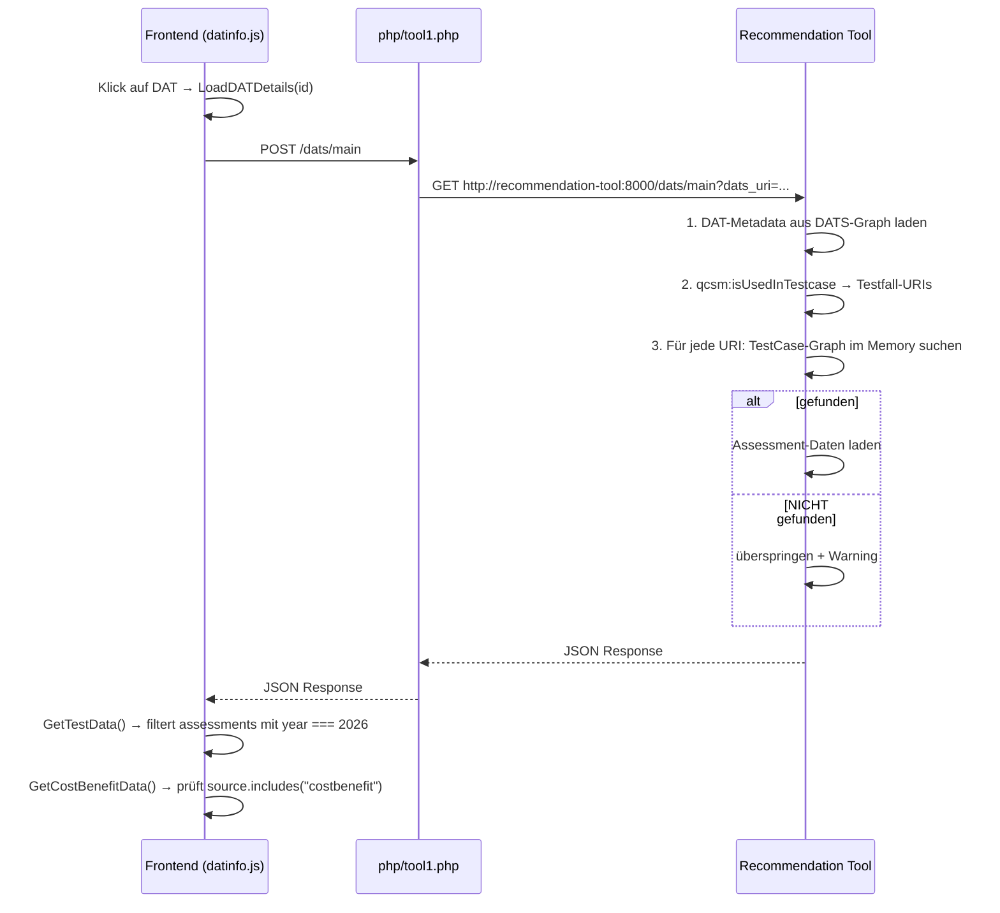

# DAT Details – Data Flow

Dieses Dokument beschreibt den Datenfluss, der beim Klick auf eine DAT im Frontend ausgelöst wird.

## Übersicht

## Schritt-für-Schritt

### 1. Frontend → Proxy
- **Trigger:** Klick auf DAT → `LoadDATDetails(id)`
- **Request:** `POST /dats/main`
- **Proxy:** `php/tool1.php` leitet den Request an den Recommendation Tool Backend-Service weiter.

### 2. Recommendation Tool (in-memory RDF-Graph)
Der Recommendation Tool verarbeitet den Request in drei Schritten:

| Schritt | Aktion | Beschreibung |
|---------|--------|--------------|
| 1 | DAT-Metadata laden | Metadaten aus dem DATS-Graph im Triple Store |
| 2 | Testfall-URIs ermitteln | Über `qcsm:isUsedInTestcase` werden zugehörige Testfall-URIs aufgelöst |
| 3 | TestCase-Daten laden | Für jede URI wird der TestCase-Graph im Memory gesucht: **gefunden** → Assessment-Daten werden geladen; **nicht gefunden** → übersprungen + Warning |

### 3. Frontend (datinfo.js)
Nach Erhalt der Daten führt das Frontend zwei Filteroperationen durch:

- **`GetTestData()`** – Filtert Assessments mit `year === 2026`
- **`GetCostBenefitData()`** – Filtert Einträge, bei denen `source.includes("costbenefit")` zutrifft