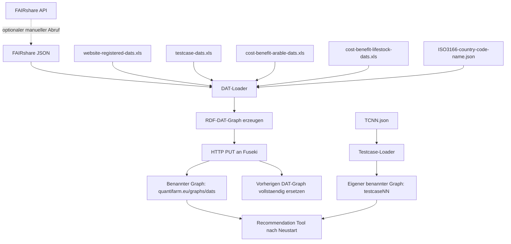

# DATs mit dem DAT-Loader aktualisieren

Diese Anleitung beschreibt, wie die DAT-Daten im QuantiFarm-Dreifachspeicher aktualisiert werden.

## Grundsatz

Der DAT-Loader ruft beim normalen Lauf keine Daten von `https://quantifarm.eu/` ab. Er liest lokale Quelldateien, erzeugt daraus einen RDF-Graphen und schreibt diesen in den benannten Graphen:

```text
https://quantifarm.eu/graphs/dats
```

Der Schreibvorgang verwendet HTTP `PUT`. Dadurch wird der bisherige Inhalt dieses DAT-Graphs vollstaendig durch den neu erzeugten Graphen ersetzt.

## Ablauf



## Quelldateien aktualisieren

Vor dem Laden muessen die folgenden Dateien im Ordner `packages/data-platform/dats-loader/` aktuell sein:

| Quelle | Datei | Inhalt |
| --- | --- | --- |
| FAIRshare | `fairshare-dats-06-2024.json` oder neuerer Export | Allgemeiner FAIRshare-DAT-Katalog |
| QuantiFarm Website-Export | `website-registered-dats.xls` | Auf der QuantiFarm-Website registrierte DATs |
| Testfaelle | `testcase-dats.xls` | Allgemeine DAT-Metadaten und Zuordnung zu Testfallnummern |
| Kosten-Nutzen, Ackerbau | `cost-benefit-arable-dats.xls` | DATs und Kosteninformationen fuer Ackerbau |
| Kosten-Nutzen, Tierhaltung | `cost-benefit-lifestock-dats.xls` | DATs und Kosteninformationen fuer Tierhaltung |
| Laender | `ISO3166-country-code-name.json` | Zuordnung von Laendernamen zu ISO-Codes |

Der Loader verarbeitet diese Quellen in dieser Reihenfolge: FAIRshare, Testfall-Excel, Website-Excel sowie beide Kosten-Nutzen-Excel-Dateien. Haben mehrere Quellen denselben DAT-Namen, werden sie ueber die daraus erzeugte DAT-URI zusammengefuehrt; einzelne Eigenschaften koennen dabei aus einer spaeteren Quelle ergaenzt werden.

## Neues FAIRshare-JSON erzeugen

Im Code existiert eine Hilfsfunktion, die die FAIRshare-API abfragt:

```text
https://api.fairshare-pnf.eu/api/tools
```

Sie ist nicht Bestandteil des normalen DAT-Loader-Laufs. Nach Installation von Python und der Python-Abhaengigkeiten kann sie manuell ausgefuehrt werden:

```powershell
cd packages/data-platform/dats-loader
py -c "from dats_loader.__main__ import check_fairshare; check_fairshare()"
```

Die Funktion erzeugt im aktuellen Ordner die Datei `data.json`. Sie veraendert den Triple Store nicht.

Die Datei sollte vor einer Verwendung geprueft und versioniert abgelegt werden, beispielsweise:

```powershell
Rename-Item data.json fairshare-dats-2026-09-03.json
```

Der DAT-Loader erwartet standardmaessig `fairshare-dats-06-2024.json`. Entweder wird der gepruefte neue Export bewusst unter diesem Namen abgelegt, oder beim Start des Loaders wird `FAIRSHARE_FILE_PATH` auf die neue Datei gesetzt.

Wichtig: Vor dem Einlesen pruefen, ob die API weiterhin die erwarteten Felder liefert, insbesondere `name`, `title`, `desc`, `launchYear`, `updateYear`, `keywords`, `sector`, `benefits`, `languages`, `countries` und `providerName`.

## DAT-Graph neu laden

Nach einer Aenderung an einer JSON- oder Excel-Quelldatei muss das Docker-Image des Loaders neu gebaut werden. Der Dockerfile kopiert die Quelldateien beim Build in das Image.

1. Sicherstellen, dass die Data Platform konfiguriert ist. In `packages/data-platform/.env` muss mindestens stehen:

   ```text
   TRIPLE_STORE_ENDPOINT=http://triple-store:3030
   ```

2. Triple Store starten, falls er nicht bereits laeuft:

   ```powershell
   cd packages/data-platform
   docker compose up -d triple-store
   ```

3. Loader mit den aktualisierten Quelldateien neu bauen und ausfuehren:

   ```powershell
   docker compose build dats-loader
   docker compose up dats-loader
   ```

4. Die Ausgabe kontrollieren. Der Loader meldet die Anzahl verarbeiteter DATs und schreibt anschliessend den neu erzeugten Graphen nach:

   ```text
   /quantifarm/data?graph=https://quantifarm.eu/graphs/dats
   ```

## Auswirkungen auf das Recommendation Tool

Das Recommendation Tool fragt beim Start den DAT-Graphen ueber den konfigurierten SPARQL-Endpunkt ab und laedt ihn in seinen Arbeitsspeicher. Nach einem erfolgreichen DAT-Loader-Lauf muss das Recommendation Tool daher neu gestartet werden, damit es den aktualisierten Graphen verwendet.

## Testcase-Daten

`testcase-dats.xls` gehoert zum DAT-Loader und beschreibt allgemeine DAT-Metadaten sowie die Verknuepfung eines DAT mit einer Testcase-Nummer. Die konkreten Versuchsdaten liegen hingegen in einer separaten Testcase-JSON-Datei, zum Beispiel `TC14.json`.

Diese JSON-Datei wird nicht durch den DAT-Loader verarbeitet. Sie wird durch den separaten `testcase-loader` in einen eigenen Graphen wie `https://quantifarm.eu/graphs/testcase14` geladen. Die Testfallnummer und die DAT-Namen muessen in Excel und JSON konsistent sein.