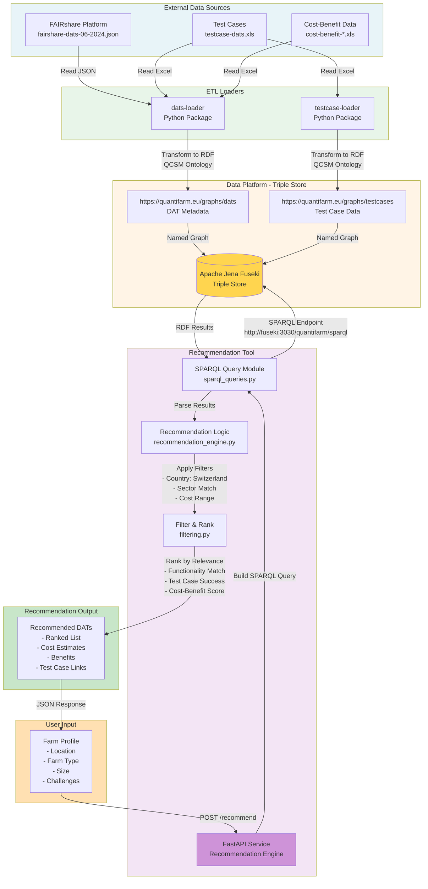

# Recommendation Tool - Data Loading Flow

## Overview
This diagram illustrates how the Recommendation Tool loads and processes data from multiple sources to generate DAT recommendations for Swiss farms.



## Data Flow Stages

### 1. **Data Ingestion** (ETL Loaders)
The Data Platform loaders process source data files and load them into the Triple Store:

#### dats-loader Process
1. **Read** FAIRshare JSON, Test Case Excel, Cost-Benefit Excel
2. **Parse** DAT metadata (name, description, provider, costs, functionalities)
3. **Transform** to RDF triples using QCSM ontology
4. **Deduplicate** based on DAT URIs
5. **Load** to Fuseki graph: `https://quantifarm.eu/graphs/dats`

#### testcase-loader Process
1. **Read** Test Case Excel with farm data and results
2. **Parse** test case metadata, farm profiles, DAT usage
3. **Transform** to RDF triples using QCSM ontology
4. **Link** test cases to DATs
5. **Load** to Fuseki graph: `https://quantifarm.eu/graphs/testcases`

### 2. **Data Storage** (Triple Store)
Apache Jena Fuseki stores data in **named graphs**:
- **DATs Graph**: Complete DAT catalog with Swiss-specific enrichments
- **Test Cases Graph**: Real-world usage examples from Swiss farms

### 3. **Recommendation Engine** (Query & Processing)

#### Step 1: SPARQL Query Construction
Based on user input (farm profile), build SPARQL query:

```sparql
PREFIX qcsm: <http://quantifarm.eu/ontology#>

SELECT ?dat ?name ?description ?cost ?functionality ?benefit
WHERE {
  GRAPH <https://quantifarm.eu/graphs/dats> {
    ?dat a qcsm:DigitalAdvisoryTool ;
         qcsm:name ?name ;
         qcsm:description ?description ;
         qcsm:country "Switzerland" ;
         qcsm:sector ?sector ;
         qcsm:functionality ?functionality ;
         qcsm:benefit ?benefit .
    
    OPTIONAL { ?dat qcsm:initialCostMin ?cost }
    
    FILTER(?sector IN ("arable farming", "livestock"))
  }
  
  OPTIONAL {
    GRAPH <https://quantifarm.eu/graphs/testcases> {
      ?testcase qcsm:usesDat ?dat ;
                qcsm:farmType ?userFarmType ;
                qcsm:success true .
    }
  }
}
```

#### Step 2: Filter & Rank
1. **Geographic Filter**: Swiss-available DATs only
2. **Sector Match**: Align with farm type (arable, livestock, mixed)
3. **Challenge Match**: DATs addressing user's stated challenges
4. **Cost Filter**: Within user's budget range
5. **Functionality Match**: Score based on required functionalities
6. **Test Case Boost**: Prioritize DATs with successful Swiss test cases
7. **Cost-Benefit Score**: Calculate ROI based on cost-benefit data

#### Step 3: Return Results
JSON response with ranked DAT recommendations:

```json
{
  "recommendations": [
    {
      "dat_uri": "https://quantifarm.eu/data/dats/farmmanager",
      "name": "FarmManager Pro",
      "relevance_score": 0.92,
      "estimated_cost": {
        "initial": 800,
        "annual": 200,
        "currency": "CHF"
      },
      "benefits": ["Increased efficiency", "Better compliance"],
      "test_cases": ["TC-CH-001", "TC-CH-015"],
      "provider": "SwissAgTech"
    }
  ]
}
```

## Key Technical Details

### SPARQL Endpoint
- **Query Endpoint**: `http://fuseki:3030/quantifarm/sparql`
- **Update Endpoint**: `http://fuseki:3030/quantifarm/update` (loaders only)
- **Graph Store**: `http://fuseki:3030/quantifarm/data`

### Data Freshness
- **Loaders run**: On container start or manual trigger
- **Update strategy**: Replace entire named graph (destructive)
- **Caching**: Recommendation Tool may cache SPARQL results (check Redis/memory cache)

### Swiss-Specific Enrichments
The Recommendation Tool adds Swiss context:
1. **Currency conversion**: EUR → CHF for cost estimates
2. **Swiss regulations**: Filter by Swiss compliance requirements
3. **Language filtering**: German, French, Italian availability
4. **Regional data**: Canton-specific recommendations if location provided

## Environment Variables

### Data Platform (dats-loader, testcase-loader)
```bash
TRIPLE_STORE_ENDPOINT=http://fuseki:3030
FAIRSHARE_FILE_PATH=/data/fairshare-dats-06-2024.json
TESTCASE_FILE_PATH=/data/testcase-dats.xls
COST_BENEFIT_ARABLE_FILE_PATH=/data/cost-benefit-arable-dats.xls
COST_BENEFIT_LIFESTOCK_FILE_PATH=/data/cost-benefit-lifestock-dats.xls
```

### Recommendation Tool
```bash
SPARQL_QUERY_ENDPOINT=http://fuseki:3030/quantifarm/sparql
PORT=8000
# Optional external data sources
WEATHER_API_URL=https://...
SOIL_DATA_URL=https://...
```

## Running the Complete Stack

### 1. Start Data Platform
```bash
cd packages/data-platform
cp .env.example .env
docker compose up -d
```

### 2. Verify Data Loaded
```bash
# Check Fuseki is running
curl http://localhost:3030/$/ping

# Count DATs
curl -X POST http://localhost:3030/quantifarm/sparql \
  -H "Accept: application/sparql-results+json" \
  -d "query=SELECT (COUNT(*) as ?count) WHERE { GRAPH <https://quantifarm.eu/graphs/dats> { ?s a <http://quantifarm.eu/ontology#DigitalAdvisoryTool> } }"
```

### 3. Start Recommendation Tool
```bash
cd packages/recommendation-tool
cp .env.example .env
# Ensure SPARQL_QUERY_ENDPOINT points to fuseki
docker compose up -d
```

### 4. Test Recommendation
```bash
curl -X POST http://localhost:8000/recommend \
  -H "Content-Type: application/json" \
  -d '{
    "farm_type": "arable",
    "size_ha": 50,
    "location": "Bern",
    "challenges": ["pest management", "soil health"]
  }'
```

## Troubleshooting

### No Recommendations Returned
1. **Check Data Platform**: Verify loaders completed successfully
2. **Check SPARQL Query**: Test query directly via Fuseki UI (`http://localhost:3030`)
3. **Check Filters**: Swiss country filter may be too restrictive
4. **Check Logs**: `docker compose logs recommendation-tool`

### Empty/Missing Data
1. **Reload DATs**: `docker compose restart dats-loader`
2. **Reload Test Cases**: `docker compose restart testcase-loader`
3. **Verify Files**: Ensure Excel/JSON files exist in `data/` directory

### Connection Errors
1. **Network**: Ensure services on same Docker network
2. **Endpoint URL**: Use service name (`fuseki`) not `localhost` in container-to-container communication
3. **Port conflicts**: Check `docker compose ps` for unhealthy services

## References

- **Recommendation Tool Documentation**: [../docs/ai-context/recommendation-tool.md](../docs/ai-context/recommendation-tool.md)
- **Data Platform Architecture**: [../docs/ai-context/data-platform.md](../docs/ai-context/data-platform.md)
- **QCSM Ontology**: [../docs/ai-context/qcsm.md](../docs/ai-context/qcsm.md)
- **DATs Loading Flowchart**: [./FaireShare_dats-loading-flowchart.md](./FaireShare_dats-loading-flowchart.md)